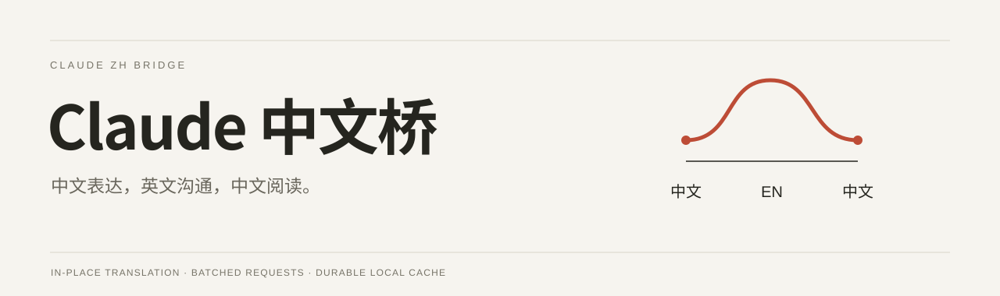
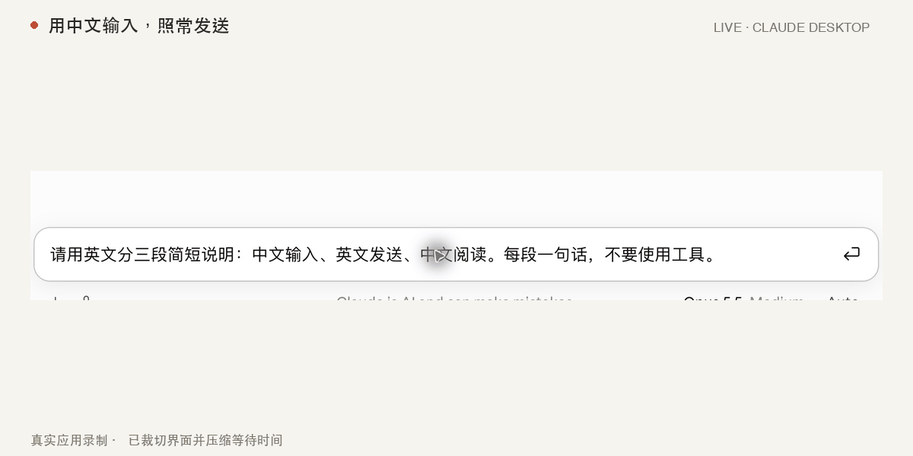

<p align="center">
  
</p>

<p align="center">
  <a href="README.en.md">English</a> · <a href="#安装">安装</a> · <a href="#真实效果">真实效果</a> · <a href="docs/privacy.md">数据与隐私</a> · <a href="CONTRIBUTING.md">参与贡献</a>
</p>

<p align="center">
  <a href="https://github.com/CNQQC/claude-zh-bridge/actions/workflows/ci.yml"></a>
  <a href="LICENSE"></a>
  
  
</p>

**在原来的 Claude 界面里，用中文输入、用中文阅读。**

中文桥在发送前将中文转换为英文，在英文回复完成后就地显示中文，并翻译侧栏会话标题。代码块、公式、链接和原生工具控件尽量保留。平时没有常驻翻译面板，已有译文保存在本机，刷新和切换对话可以继续使用。

> 独立开源项目，非 Anthropic 或 DeepSeek 官方扩展。公开版本不含 API Key。桌面版通过可恢复的本地补丁工作，目前仅验证 **Claude Desktop 3.1623.0**。

## 真实效果

<p align="center"></p>

这段 GIF 来自实际安装了中文桥的 **Claude Desktop**：使用专门的演示对话，录下英文回复转为中文以及刷新后的恢复。只做界面裁切、缩放、字幕和等待时间压缩，没有替换消息或合成聊天界面。账户、历史侧栏和本机路径未进入最终画面。[静态预览](docs/media/claude-live.png) · [录制说明](docs/demos/README.md)

## 适合这些场景

| 你正在做什么 | 中文桥如何配合 |
| --- | --- |
| 用中文梳理需求 | 正常点击发送或按 Enter，先翻译，再提交；已发送消息显示原中文稿。 |
| 阅读较长的英文回答 | 等回复稳定后，原位置显示中文，保留段落、列表和表格。 |
| 在 Desktop Code 中跟进多轮工具调用 | 翻译工具调用前后的说明段落；代码、终端输出和批准控件保留原样。 |
| 回到昨天的对话 | 从本机恢复译文，成功翻译不因刷新、切换页面或重启而重新提交。 |
| 在侧栏寻找会话 | 具体会话标题显示中文，保留原来的排序、状态、菜单与点击行为。 |

需要英文时，悬停或聚焦消息旁的 **EN / 中** 控件即可切换。原文仍在页面中；Claude 原生复制按钮通常仍复制原文，复制中文可以直接选中译文。

## 翻译开支，先从少发请求开始

同一轮已稳定的正文块、Code 段落与侧栏标题会统一收集，先排除已有缓存、重复内容和正在处理的片段，再合并提交。输入翻译单独处理，不等待显示任务凑批次。

```text
待译正文 + 会话标题
       │
       ├─ 已有译文 ──────────────────→ 直接恢复
       ├─ 相同片段 / 正在处理 ────────→ 共享结果
       └─ 新的未缓存片段 ────────────→ 一次批量请求 → 保存 → 显示
```

| 验证场景 | 请求行为 |
| --- | --- |
| 70 个 Code 短段落 + 1 个标题 | 在回归用例中合并为 **1 次**模型请求。 |
| 重复内容出现在多个块或标签页 | 只提交未缓存的唯一片段，结果按各自顺序回填。 |
| 重新载入已翻译内容 | 复用持久缓存，成功结果不重新提交。 |
| 超长历史对话 | 按约 6000 个未缓存字符的输出预算拆批，避免译文被截断。 |

合并主要减少重复提示词和请求开销，**不会让待翻译正文免费，也不承诺固定节省比例**。上述 70+1 是模拟接口的回归场景；真实接口的独立验证另外确认过 3 个块合并为 1 次请求。[验证范围](docs/verification.md)

## 安装

### Chrome 插件

1. 从 [Releases](https://github.com/CNQQC/claude-zh-bridge/releases/latest) 下载 `claude-zh-bridge-extension-*.zip` 并解压到固定目录。
2. 打开 `chrome://extensions`，开启「开发者模式」，点击「加载已解压的扩展程序」，选择包含 `manifest.json` 的文件夹。
3. 点击工具栏中的中文桥，填写**自己的 DeepSeek API Key** 并验证。
4. 打开或刷新已保存的 `claude.ai` 对话，照常使用。

Chrome Key 当前保存在受限的**浏览器会话存储**中，重启浏览器后需要重新填写；翻译结果与偏好长期保存在本机。更新时覆盖原插件目录后重新加载，保留扩展 ID；不要先卸载或清除扩展数据。

### macOS 桌面版

1. 下载 [Releases](https://github.com/CNQQC/claude-zh-bridge/releases/latest) 中的 `claude-zh-bridge-macos-arm64-*.zip`，解压并打开「Claude 中文桥」。
2. 在「接口」中填写自己的 Key。默认 `https://api.deepseek.com`、`deepseek-flash`，显式关闭思考；桌面版可以修改 HTTPS 接口、模型和 Chat / Code 生效范围。
3. 等正在运行的 Claude 任务结束，完全退出 Claude，再点击「安装补丁」。工具先保存原版备份，再校验、安装和本地签名。
4. 重新打开 Claude。如出现系统钥匙串或身份确认，请在 macOS 系统窗口中自行处理。

需要 **Apple Silicon、macOS 14+、Claude Desktop 3.1623.0**。当前未验证 Intel、Windows、Linux；工具会拒绝安装到未验证的 Claude 版本。开源安装包使用本地签名，尚未做 Apple 公证，请按 macOS 系统提示检查和处理。

<details>
<summary><strong>桌面补丁会改动什么？如何恢复？</strong></summary>

它修改所选 Claude 的应用资源，使用本地签名替代供应商签名，并仅对该应用添加动态库签名匹配例外。SIP、Gatekeeper、沙箱和 ASAR 资源完整性检查保持启用；工具不会关闭官方更新。

安装器保留原版文件和签名，使用文件哈希校验、安装锁、原子替换与中断恢复。官方更新或文件状态变化后会停止覆盖。在工具中点击「恢复原版」可以恢复原始应用和签名，保留账号数据、聊天记录与翻译缓存。

已有旧版补丁时，请先使用工具导入**你自己的原版备份清单**。公开仓库和安装包不包含任何 Claude 原程序、个人备份或安装记录。详见 [桌面安装与恢复](docs/desktop.md)。

</details>

## 支持范围

| 入口 | 状态 | 说明 |
| --- | --- | --- |
| Chrome 中的 Claude Chat | 支持 | Manifest V3，桌面 Chrome 120+。 |
| Claude Desktop Chat | 支持 | 当前验证版本见上方。 |
| Claude Desktop 左侧 Code | 支持 | 翻译会话说明，保留原生工具和批准控件。 |
| 终端中的 `claude` CLI | 不支持 | 本项目不代理 CLI 输入输出。 |
| 设置页、项目管理页、公开分享页 | 不启用 | 不修改内容，也不接受这些页面的翻译请求。 |
| 图片、语音、附件内容、独立 Artifact | 不翻译 | 当前只处理支持会话界面中的文本。 |

## 数据与隐私

- **自己提供 Key。** 公开源码、构建包和演示素材均不含作者或用户凭据。
- **只发送需要翻译的文字。** 默认发往 DeepSeek；桌面版使用你配置的接口。译文缓存留在本机，没有项目自建中转、分析统计或遥测服务。
- **不自动重试结果未知的付费请求。** 请求前先保存处理中标记；失败或中断后等待手动重试，避免静默重复计费。
- **成功结果长期保留。** 修改桌面接口或模型会使用独立缓存，原有结果保留；改回原配置可以继续复用。

缓存本身可能包含聊天文字，请像保护聊天记录一样保护它。Chrome 卸载扩展或清除扩展数据可能删除缓存。[完整数据流与存储位置](docs/privacy.md)

## 本地开发

```sh
git clone https://github.com/CNQQC/claude-zh-bridge.git
cd claude-zh-bridge
npm ci
npm test
npm run package:extension
```

macOS 原生工具需要 Xcode Command Line Tools：

```sh
sh scripts/test_native.sh
npm run build:mac
```

`extension/` 是 Chrome 与桌面版共用的运行时来源；`npm run build` 生成隔离 preload 和桌面资源，避免维护两份翻译逻辑。所有默认测试使用虚构 Key、模拟接口和临时目录，不发送真实付费翻译，也不修改已安装的 Claude。

```text
extension/          翻译、缓存、DOM 适配、Chrome 设置
 desktop/bridge/   Electron 隔离 preload、来源校验、持久存储
 desktop/patcher/  SwiftUI 安装器、签名、备份与恢复
 scripts/          构建、打包与公开内容检查
 docs/             使用说明、数据流、验证与实际演示
```

## 一起改进

欢迎提交带有复现步骤的兼容性报告、翻译边界案例和可复用测试。提交前请删除截图中的账户、会话标题、本机路径和 Key；不要上传聊天缓存或 Claude 应用原文件。参见 [贡献指南](CONTRIBUTING.md) 与 [安全报告](SECURITY.md)。

如果它让你的 Claude 使用过程更顺手，欢迎 Star，也欢迎将具体问题变成一个可以复现的 Issue。

[MIT License](LICENSE) · Claude 与 DeepSeek 名称归各自权利人所有；本项目与其没有隶属或背书关系。
